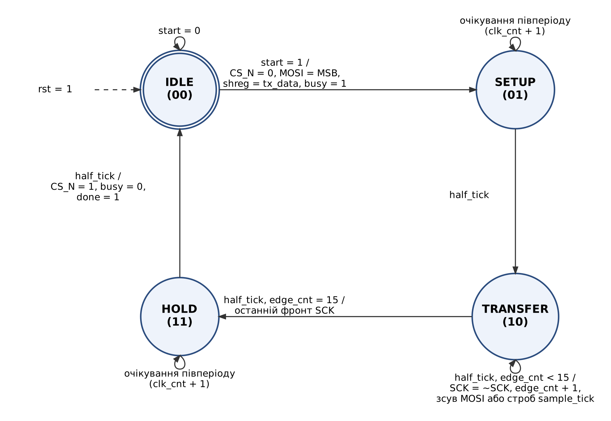
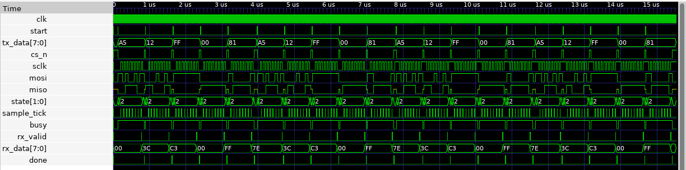
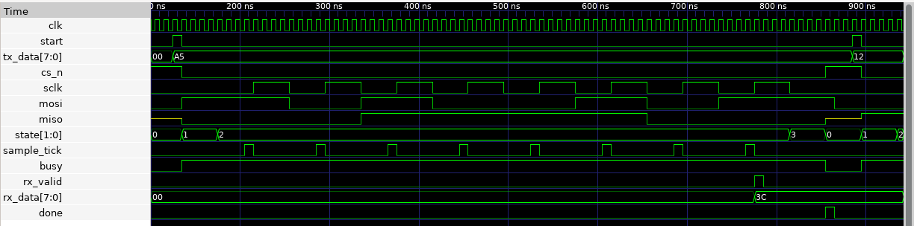
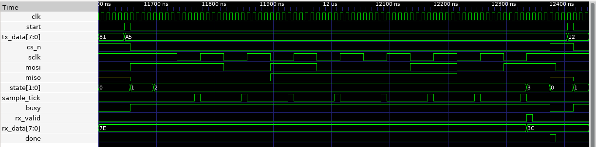

# Лабораторна робота №3 — SPI Master на Verilog

**Варіант 12:** протокол SPI, мова Verilog.
**Виконав:** Кравченко Віктор, КІ-405.

## Що реалізовано

SPI Master з повнодуплексним обміном 8-бітними кадрами (старшим бітом уперед):

- **spi_master_tx** — передавач: дільник частоти (SCK = CLK / (2·CLK_DIV)), скінченний автомат IDLE → SETUP → TRANSFER → HOLD, керування CS_N, видача бітів на MOSI;
- **spi_master_rx** — приймач: фіксує MISO на фронті фіксації SCK і збирає байт, видає `rx_data` та імпульс `rx_valid`;
- **spi_master** — верхній рівень, що з'єднує Tx і Rx;
- підтримуються всі чотири режими SPI (CPOL/CPHA = 00, 01, 10, 11), режим задається входами `cpol` і `cpha`.

Діаграма станів передавача:



## Структура

```
lab3/
├── rtl/            модулі, що синтезуються
│   ├── spi_master_tx.v
│   ├── spi_master_rx.v
│   └── spi_master.v
├── tb/             симуляція
│   ├── spi_slave_model.v   модель зовнішнього Slave-пристрою
│   └── spi_master_tb.v     тестбенч
├── sim/
│   └── spi_master_tb.gtkw  набір сигналів для GTKWave
├── constraints/
│   └── spi_master.lpf      тактова частота 100 МГц (nextpnr)
├── scripts/
│   ├── run_sim.bat / .sh   симуляція + осцилограми
│   └── run_synth.bat / .sh синтез, ресурси, Fmax
└── docs/
    ├── fsm_tx.png          діаграма станів
    └── sim_*.png           осцилограми з GTKWave
```

## Інструменти

Відкритий набір САПР [OSS CAD Suite](https://github.com/YosysHQ/oss-cad-suite-build) (випуск 2026-11-01):
Icarus Verilog (симуляція), GTKWave (осцилограми), Yosys (синтез), nextpnr-ecp5 (розміщення, трасування, часовий аналіз).
Цільова ПЛІС: Lattice ECP5 LFE5U-25F-6BG381C (плата ULX3S).

## Як запустити (Windows)

1. Розпакувати OSS CAD Suite у `C:\oss-cad-suite` (або задати змінну `OSS_CAD`).
2. Симуляція: подвійний клік на `scripts\run_sim.bat` — у вікні з'явиться звіт тестбенча, потім відкриється GTKWave.
3. Синтез: подвійний клік на `scripts\run_synth.bat` — наприкінці буде виведено ресурси та Fmax.

На Linux/macOS — `scripts/run_sim.sh` і `scripts/run_synth.sh`.

## Осцилограми (GTKWave)

Увесь тест — 20 кадрів у чотирьох режимах:



Кадр у режимі 0: Master передає A5h, Slave відповідає 3Ch:



Кадр у режимі 3 (CPOL = 1, CPHA = 1):



## Результати

- Тестбенч: 4 режими SPI × 5 пар байтів (A5h/3Ch, 12h/C3h, FFh/00h, 00h/FFh, 81h/7Eh), перевірка обох напрямків, кількості біт, рівня SCK у спокої та фронту фіксації — `=== TEST PASSED: 20/20 transfers OK ===`.
- Синтез для LFE5U-25F: 51 LUT4, 44 тригери, Fmax ≈ 258 МГц при обмеженні 100 МГц.

Тестбенч також автоматично запускається в GitHub Actions (`.github/workflows/spi_tb.yml`) при зміні файлів у `lab3/`.
